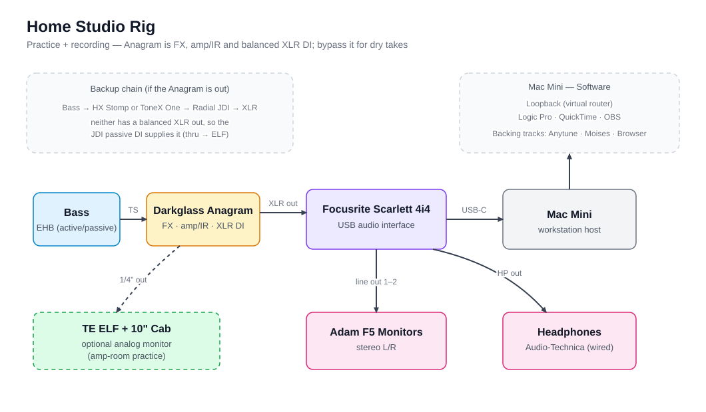
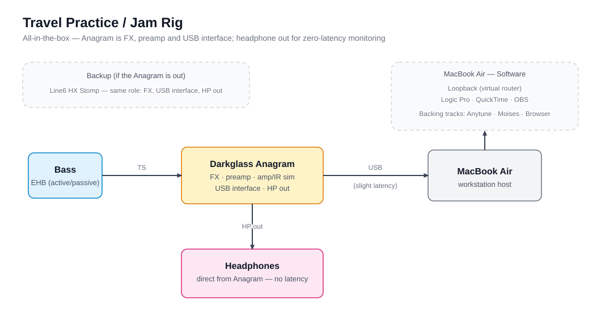
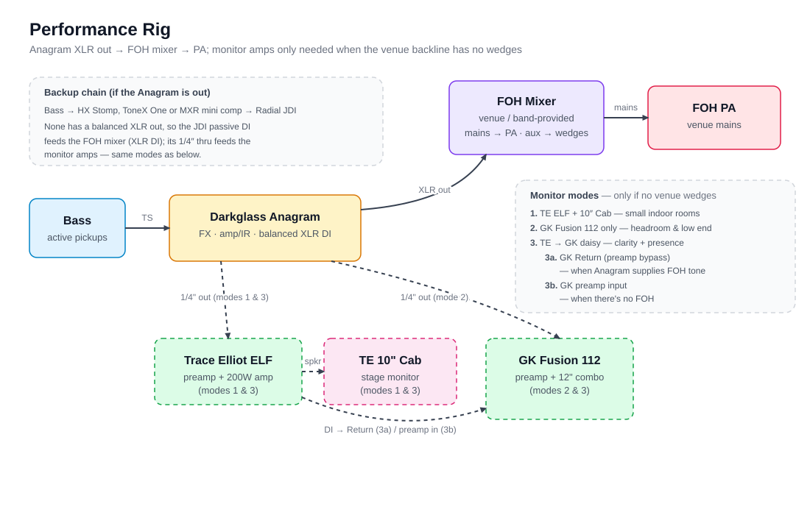

# Bass Rigs

This project documents the rigs I use on bass — for practice, performance, and
content creation. The concepts apply to other instruments (guitar, keys, etc.),
but the specifics here are bass-focused.

It starts with a **general framework** that describes the components a rig can
contain as concepts, then lays out the **three setups** I actually run —
[Home Studio](#home-studio-rig), [Travel Practice / Jam](#travel-practice--jam-rig),
and [Performance](#performance-rig) — each with a diagram and its benefits and
tradeoffs. A [Future Directions](#future-directions) section covers what may
change the setups going forward.

## Objectives

### Practice

A practice regimen requires:

- The ability to play and clearly hear what I'm playing
- Playing with or against some form of backing track (or metronome)

The ability to record is useful for:

- Sharing with others (e.g. an instructor)
- Self-review

### Performance

The point of performance is to play well and sound good for others — working
with venues' sound engineers and their platforms.

### Content Creation and Music Production

Content creation includes building instrument tracks as part of song
construction. Instrument and gear choices help craft the tone a song demands.

This leans on sound engineering and music production skills, built through
iterative experimentation with gear (on top of proficiency on the instrument).
Gear gets expensive though — GAS is real — so the setups below favor a small
number of flexible, reusable components over sprawl.

## Rig Framework

Before the specific setups, it's useful to describe what components can sit in a
rig and where each tends to sit in the signal chain:

1. **Instrument** — the bass.

2. **FX** — effects, which may include:
   - Dynamics (compression)
   - Distortion / overdrive
   - Modulation
   - EQ / filtering
   - Time / spatial (delay, reverb)
   - Pitch / harmony

3. **Preamp / Amp** — tone shaping and amplification, optionally with **IR / cab**
   simulation.

4. **DI** — feeds Front-of-House (FOH) PA, and can tap a parallel feed for
   on-stage / monitor amplification. The **Darkglass Anagram** supplies this
   directly from its balanced XLR out, keeping the DI feed consistent across rigs
   and independent of whatever monitor amp is in use that night. A standalone
   passive DI (Radial JDI Jensen) is only needed for the backup chain (see below).

5. **ADDAC** (A/D–D/A converter — device + software driver) — the audio interface:
   - Inputs from the signal chain (the instrument can bypass upstream gear and go
     direct here), typically 2–4 channels.
   - Outputs (2–4 channels) to studio monitors and/or headphones.
   - Exposes channels to the workstation for routing.

6. **Workstation** — the host computer and its audio routing:
   - **Virtual router** (Loopback on Mac) aggregates and routes sources — see the
     [Loopback configuration & backup guide](./rigs/home/loopback-configuration-guide.md)
     and the [router layout](./rigs/home/loopback-configuration.png):
     - Backing-track sources route to a stereo output pair.
     - Instrument inputs from the ADDAC route to separate output pairs.
     - A monitor mix sends the combined output back to the ADDAC for audio.
   - **Backing-track sources** feeding the router:
     - *Live* — browser streaming, gaming, or streaming software.
     - *Pre-recorded* — music/video players, DAW, browser/app-based.

   The goal is to keep routing simple so software processors (DAWs, streaming/
   recording) have a consistent set of inputs to work from.

7. **Signal processors** (running on the workstation):
   - **Recording software** — simple live capture (e.g. QuickTime) for quick shares.
   - **DAW** (Logic Pro on Mac) — edit, mix, master. Pre-recorded backing tracks
     import directly as audio; instrument and backing tracks can also be recorded
     live. **DAW plugins (VSTs) can supply FX, preamp, amp and IR** inside the box,
     which changes what physically needs to be in the signal chain.
   - **OBS** — video capture, streaming, recording. Sources include the display,
     web cams, and any of the router outputs / monitor mix / external mics. Scenes
     set up the video + audio layout.

> The lines between **FX (2)**, **Preamp/Amp (3)** and **DI (4)** blur, because
> some devices play several roles. The Darkglass Anagram, for example, provides FX,
> amp/IR simulation *and* a balanced XLR DI out in a single box.

> **Backup chain.** The Anagram is my primary bass DSP; the **Line6 HX Stomp** has
> been repurposed for my guitar signal chain. If the Anagram is unavailable, the
> HX Stomp or an **IK Multimedia ToneX One** stands in. Neither has a balanced XLR
> out, so the backup chain adds the **Radial JDI Jensen** passive DI:
> Bass → HX Stomp / ToneX One → JDI → XLR DI out (to the interface or FOH), with
> the JDI's 1/4" thru feeding any monitor amp.

The signal chain varies by setup — any of the components above may or may not be
present depending on context. The three setups I run are below.

## Setups

### Home Studio Rig

Optimized for practice and recording. It can be used purely for practice, for
recording with the Anagram's tone, or for recording **dry** (Anagram bypassed)
with FX added to the dry track in the DAW.

- **Instrument** — typically an EHB-style bass with both active and passive
  pickup/EQ options.
- **FX + Preamp + DI** — a **Darkglass Anagram** is always in line. Bypass it
  (or use a clean preset) for dry takes, or engage it when experimenting with or
  crafting tones — FX can equally be handled in the DAW (see below). Its balanced
  **XLR out** feeds the Scarlett; its **1/4" out** optionally feeds the Trace
  Elliot ELF + 10" cab for an analog monitor (amp-room practice without the
  workstation).
- **Backup** — HX Stomp or ToneX One → Radial JDI, as in the
  [backup chain](#rig-framework) above.
- **ADDAC** — Focusrite Scarlett 4i4 (Gen 3), out to **Adam F5** studio monitors
  and Audio-Technica wired headphones.
- **Workstation** — a **Mac Mini** hosts the workstation, with **Loopback** as the
  virtual router.
- **Capture** — QuickTime (quick shares), Logic Pro (recording / backing tracks,
  with FX added downstream of the dry track via VSTs), and OBS (audio + video
  performance recording).

#### Benefits

- Clean, dry takes — maximum flexibility for mixing/mastering decisions later.
- Simplified signal path — one box between bass and interface; fewer variables
  to manage during a take.
- Best monitoring of the three setups (studio monitors + quality headphones).
- Encourages separating the performance from the tone shaping.

#### Tradeoffs

- Fixed location — the least portable setup.
- Requires discipline around mixing/mastering to land a finished sound.
- Less immediate "feel" without an FX chain coloring the performance.

> **Deep dives:** [Setup guide](./rigs/home/studio-rig-setup-guide.md) ·
> [Bill of materials](./rigs/home/studio-rig-bom.md) ·
> [Loopback configuration & backup](./rigs/home/loopback-configuration-guide.md)
> (router layout shown in [loopback-configuration.png](./rigs/home/loopback-configuration.png)).

### Travel Practice / Jam Rig

A general-purpose, minimal setup that isn't optimized for any single objective —
it trades quality and screen space for portability.

- **Instrument** — typically an EHB-style bass with active/passive options.
- **FX + Preamp + ADDAC** — a **Darkglass Anagram** does all three: FX,
  preamp/amp-IR, and the USB audio interface. Its **headphone out** provides a
  zero-latency monitoring path for practice/performance.
- **Backup** — the **Line6 HX Stomp** fills the same role (FX, USB interface,
  headphone out) if the Anagram is unavailable. No DI is needed here, since
  nothing feeds a PA.
- **Workstation** — a **MacBook Air** hosts the workstation, with **Loopback** as
  the virtual router.
- **Capture** — QuickTime, Logic Pro, and OBS, same as the Home Studio.

#### Benefits

- Highly portable — collapses to a bass, one box, a laptop, and headphones.
- All-in-the-box FX/amp/IR; presets travel with you.
- Headphone-out path removes USB latency during practice.

#### Tradeoffs

- Audio quality compromise (headphones over monitors; small box over dedicated gear).
- Latency disparity between the direct headphone path and the USB/DAW path.
- Limited CPU can reduce audio streaming/sampling quality.
- Limited screen real estate.

### Performance Rig

Built to sound good for gigs and to stay flexible with venue sound systems and
constraints.

- **Instruments** — usually a couple of traditional-style basses with onboard
  active pickups for tonal/EQ options. This keeps tone control at the bass, though
  it's rarely needed.
- **FX + Preamp + DI** — a **Darkglass Anagram** (FX + preamp/IR). Its balanced
  **XLR out** goes to FOH; its **1/4" out** drives whichever monitor amp(s) are on
  stage. For gigs where carrying a combo isn't practical, only the Anagram → FOH
  path is needed.
- **Backup** — HX Stomp, ToneX One, or a simple compressor (MXR mini series) →
  **Radial JDI Jensen** passive DI, since none of them has a balanced XLR out. The
  JDI's XLR DI out goes to FOH and its 1/4" thru feeds the monitor amps, in the
  same configurations below.
- **Monitor amp(s)** — three configurations, picked per venue:
  1. **TE ELF + 10" cab only** — small indoor rooms / coffee-shop gigs.
  2. **GK Fusion 112 only** — more headroom and stronger low end / stage presence,
     trading some midrange clarity.
  3. **TE ELF + GK Fusion 112 daisy-chained** — Anagram 1/4" out into the TE ELF
     (driving the 10" cab), then the ELF's DI out into the GK. Two variants:
     - **GK Return** (preamp-bypass) when the Anagram is supplying FOH tone —
       the most transparent monitor stack, leaning on Anagram presets for
       character.
     - **GK preamp input** when there's no FOH and the TE + GK are the only
       amplification — keeps the GK preamp model in the chain.
- **Capture** — not currently used for live gigs, though a more formal venue/band
  capture for live recordings (with extended mixing and DAW input) may be designed
  in later.

#### Benefits

- Same Bass → Anagram signal path as the Home Studio — consistent tone and
  presets, and one fewer thing to relearn between contexts.
- Decouples FOH from the monitor amps; can show up with no combo at all and still
  hand FOH a balanced DI feed straight from the Anagram.
- A documented backup chain (HX Stomp / ToneX One → JDI) if the Anagram fails.
- Three monitor configurations to suit the room — small indoor, larger outdoor,
  or daisy-chained for both clarity and headroom.

#### Tradeoffs

- Worst portability of the three; carrying both combos for the daisy-chain
  config is hard on travel gigs.
- More boxes on stage than a one-amp setup.
- The backup chain reintroduces the JDI, so it has to travel in the gig bag.
- No live capture path today.

> **Deep dive:** [Band gig configuration](./rigs/gig/band-gig-configuration.md) —
> a full-band FOH PA (owned by bandmates) that this rig plugs into via its XLR DI feed, with
> [signal-chain](./rigs/gig/gig-signal-chains.svg) and
> [power-topology](./rigs/gig/gig-power-topology.svg) diagrams.

## Future Directions

A few directions under research could change the setups above:

1. Transition the workstation from macOS to a **Linux** platform.
2. Switch the DAW from Logic Pro to **Reaper**.

Two primary reasons drive these:

- **Mac platform obsolescence for audio gear.** In late 2026, Apple drops Rosetta
  Intel emulation. It's questionable whether Apogee or Focusrite will ship Apple
  Silicon drivers, Logic Pro is Mac-only, and Reaper runs well on SteamOS/Linux —
  which opens interesting options for live recording.
- **Simplifying live rigs.** Modern software FX + preamp/amp/IR modelers fit in one
  device, simplifying workflow and presets. The **Darkglass Anagram** (now being
  phased in) realizes this for bass: integrated cab sim *and* a balanced XLR DI
  out replace both the HX Stomp and the JDI in the primary chain.

## Reference

- [Sample bill of materials](./rigs/home/studio-rig-bom.md) — representative gear,
  software, cabling, and ballpark costs across the setups above.
